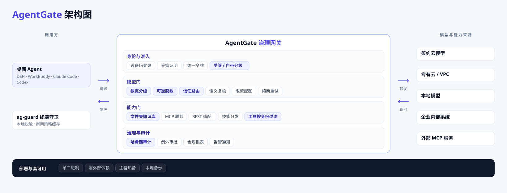

# AgentGate

[](https://github.com/myjnathan/AgentGate/actions/workflows/ci.yml)

**不绑定任何 Agent 的企业 AI 治理层。** 员工的 Agent 随便换，企业的能力、权限和账本不动。
*An enterprise AI governance layer that doesn't bind to any agent. Employees keep their own agents; the company keeps its capabilities, permissions and audit trail.*



## 适合谁 / 不适合谁

适合没有自有模型、没有数据库、也没有知识库的传统公司——想让员工用 AI 干活，又怕公司数据跟着出去。部署只需一台服务器，不需要先整理知识库、不需要先有 GPU。

不适合只想接个模型 API、或已经有一整套成熟 AI 平台的大公司；也不适合只做聊天机器人、不管数据去向的场景。

## 核心能力：三道门

- **模型门**——模型网关按数据密级选路：公开/内部走签约云，机密默认脱敏后上云（原文不出公司、响应还原），绝密只走本地小模型、无合规通道时明确拦截。自带级 Agent 发机密数据默认拦截，渠道信任类型、熔断、多密钥与配额都在这一道门里；提示词注入规则层按消息来源打标，拦下藏在工具返回里的可疑指令（详见 [docs/prompt-injection.md](docs/prompt-injection.md)）。
- **能力门**——MCP 网关与知识库：工具按调用者身份授权（看不见即调不了），共享文件夹即知识库（按文件夹映射密级、引用精确到文件+章节+页码），技能与 Prompt 模板走提交→审核→发布，版本不可变。
- **网络门**——端侧 ag-guard 与受管 Agent：设备码接入、Agent 证明（版本/配置哈希/插件清单不符降级并告警）、插件策略（白名单/黑名单 + 版本/哈希三元组，登录与心跳共用同一评估）、终端持续盘点与断网策略缓存；涉及企业加密文件时，只有通过准入标准的受管 Agent 能读明文，进程白名单 + 出口守卫，只准连企业网关。

三道门共用同一条审计：哈希链防篡改，原文与敏感值不落日志；合规报表与告警让审计有人看。

## 快速开始

需要 Go 1.27+。

```bash
go build -o agentgate ./cmd/agentgate
AGENTGATE_MASTER_KEY=change-me-please-16+ ./agentgate
# 打开 http://127.0.0.1:8787，输入日志里的一次性设置码创建第一个管理员
```

三步装好：起服务 → 输设置码建管理员 → 五步向导（选行业模板 → 接模型渠道，只填 API Key → 选上线阶段）。**第一天默认观察模式**：只审计、不拦截，先跑起来、再看仪表盘的「本应拦截」计数决定何时进阶到拦截。演示模式（`AGENTGATE_DEMO=1`）内置 mock 模型，无需真实 API Key 即可体验完整闭环，演示账号见 [docs/onboarding.md](docs/onboarding.md)。

## 交付形态

- **管理包（给 IT）**：agentgate 服务端，Docker 镜像 / 离线 bundle / systemd，含管理台。
- **用户包（给员工）**：ag-guard + ag-setup 打成一个可安装包，管理员在管理台按策略生成，员工装一次即常驻、零配置；包哈希自动登记为 Agent 证明的基准值。

## 边界与弱点（明说）

AgentGate 只防**电脑内的数字数据流**：模型调用、工具调用、文件外发。员工拍照、默记、口述等人的行为不在防护范围内，归客户保密制度管。防护边界与管理兜底的完整讨论见 [docs/enterprise-protection-design.md](docs/enterprise-protection-design.md) §2。

## 文档索引

- 设计蓝图 [docs/blueprint.md](docs/blueprint.md) · 企业防护设计 [docs/enterprise-protection-design.md](docs/enterprise-protection-design.md)
- 首次开通与上线阶段 [docs/onboarding.md](docs/onboarding.md) · 交付体验 P1（导航 / 厂商预设 / 词表） [docs/delivery-p1.md](docs/delivery-p1.md) · 部署与离线包 [docs/package-distribution.md](docs/package-distribution.md) · 双机热备方案 [docs/ha-design.md](docs/ha-design.md) · 阶段三状态外置评审 [docs/ha-phase3-design.md](docs/ha-phase3-design.md) · 备份与恢复运维手册 [docs/backup.md](docs/backup.md) · 功能清单 [docs/feature-backlog.md](docs/feature-backlog.md)
- 开发循环 [docs/development-loop.md](docs/development-loop.md) · 开发日志 [docs/DEVLOG.md](docs/DEVLOG.md)

## 许可证

**GNU AGPL-3.0** — 见 [LICENSE](LICENSE)。任何人可免费使用（含商用）；修改后分发、或以网络服务形式向他人提供时，须以 AGPL-3.0 公开对应源代码。
